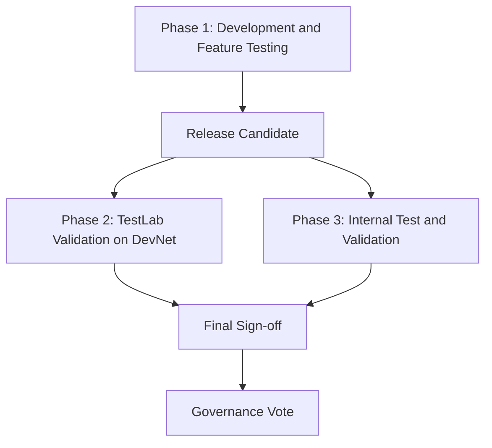

> 🔄 **Auto-sync:** from [Discussion #2076](https://github.com/gonka-ai/gonka/discussions/2076) every hour. 

# DevShard Release Testing Flow

**Автор:** [@aikuznetsov](https://github.com/aikuznetsov) · **Категория:** :jigsaw: Ecosystem · **Создано:** 2026-10-21 13:28 UTC · **Обновлено:** 2026-10-21 13:41 UTC

---

## 📝 Описание

## Purpose

Define a repeatable testing flow for DevShard releases, with clear ownership and handover criteria. The flow covers development testing, parallel independent and internal validation, final sign-off, and release rollout.

Participants:

- **Dev team:** implements changes, tests new functionality, prepares release candidates, and fixes reported issues.
- **TestLab:** independently validates release candidates on DevNet, focusing on regression, load, upgrades, and rollbacks.
- **Internal validation team:** validates integration with the rest of the system and reports readiness for release.

## Flow Overview

Phases 2 and 3 run in parallel against the same release candidate. Final sign-off requires results from both tracks for the candidate being released.

## Phase 1: Development and Feature Testing

**Owner: Dev team**

During active development, the Dev team implements new functionality and runs:

- Unit tests for the changed behavior.
- End-to-end tests for the affected workflows.
- Load tests for new functionality, including relevant performance and resource usage checks.

### Exit Criteria and Handover

Once development is complete, all required tests pass, and CI is green, the Dev team creates a release candidate Git tag. The tag automatically produces the binaries and container images used for testing.

The handover to TestLab and the internal validation team includes:

- The release candidate tag and links to its build artifacts.
- A summary of changes, affected components, and known limitations.
- Deployment configuration and upgrade and rollback procedures.
- A proposed release-specific test scope and relevant development test results.

## Phase 2: Independent Validation on DevNet

**Owner: TestLab**

TestLab deploys the tagged release candidate on DevNet and validates the release as a whole. The Dev team and TestLab agree on the test scope based on the changes and risks introduced by the release.

### Common Test Scope

| Area | Expected validation |
| --- | --- |
| Regression | Existing functionality and end-to-end workflows continue to work correctly. |
| Load and stability | The system handles sustained load and load spikes; latency, throughput, errors, and resource usage are measured against an agreed baseline. |
| Memory behavior | Memory usage is monitored during load, recovery, and extended runs to identify leaks or unexpected growth. |
| Upgrades | Supported previous versions can be upgraded to the candidate using the documented procedure, including under load where applicable. |
| Rollbacks | The documented rollback path is exercised, with checks for service recovery and state compatibility. Any rollback limitations are recorded. |
| Observability | Metrics and logs from DevShard and Gateway provide enough evidence to evaluate behavior and investigate failures. |

### Bug Reports and Testing Tools

When an anomaly is detected, TestLab promptly provides the Dev team with a bug report containing the candidate tag, environment details, workload, reproduction steps, timestamps, full relevant log archives, metrics, and available profiles. The report should give developers enough context to investigate without repeating the initial evidence collection.

Use and maintain automated tooling for running tests, collecting logs and profiles, and comparing results with a baseline.

### Operator Instructions

TestLab validates clear, step-by-step operator instructions by exercising the deployment, upgrade, verification, and rollback procedures on DevNet. Gaps found during testing are corrected before handover.

### Exit Criteria and Results

TestLab provides a test report identifying:

- The exact candidate and environment tested.
- Scenarios executed, results, and baseline comparisons.
- Open issues, their impact, and any untested areas.
- Verified upgrade and rollback paths, including limitations.
- Validated operator instructions.

The proposed exit criteria are that the agreed scope passes and no release-blocking issues remain. Fixes produce a new candidate tag; TestLab reruns the affected checks and the regression coverage needed to validate that candidate.

## Phase 3: Internal Test and Validation

**Owner: Internal validation team**

This phase runs in parallel with Phase 2 and validates how the new DevShard version works with the other system components. The team selects integration checks based on the affected interfaces, dependencies, and workflows.

### Test Scope

| Area | Expected validation |
| --- | --- |
| Component integration | DevShard interacts correctly with dependent services and components. |
| Interface compatibility | APIs, message formats, and shared contracts remain compatible with supported component versions. |
| End-to-end integration | Workflows spanning multiple components complete correctly with the new version. |
| Failure and recovery | Cross-component error handling, retries, and recovery behave as expected. |
| Configuration and deployment | Supported configurations and deployment settings work across the integrated system. |

### Exit Criteria and Results

The internal validation team provides a report identifying the candidate, component versions, environment, checks performed, results, and any open issues or coverage gaps. The agreed integration scope must pass with no release-blocking issues remaining.

Issues are reported to the Dev team with reproduction details and supporting logs. When a new candidate is produced, both validation tracks reassess the affected checks and rerun the coverage needed to confirm readiness.

## Final Sign-off and Release

After Phases 2 and 3 are complete, the Dev team, TestLab, and internal validation team review the results for the same candidate and record a final readiness decision.

Sign-off requires:

- Passing results for the agreed scope in both validation tracks.
- No unresolved release-blocking issues, with remaining limitations and risks documented.
- Confirmed release artifacts and validated operator instructions.
- A documented rollout and rollback plan, including post-release checks.

If a governance vote is required, the approved candidate and supporting release information are submitted for voting. Rollout proceeds only after the proposal is approved. Otherwise, rollout proceeds through the applicable release approval process after sign-off.

During rollout, the release owners monitor service health, errors, performance, and resource usage and verify the critical workflows. If the agreed rollout criteria are not met, they stop further deployment and follow the documented recovery or rollback procedure.

