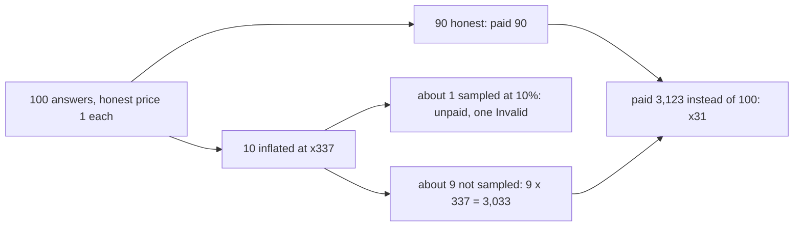
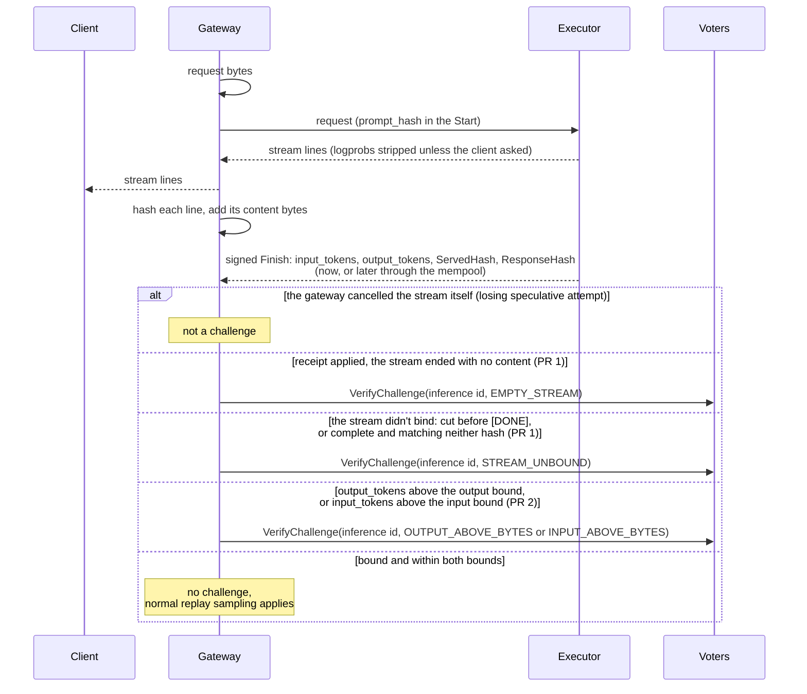
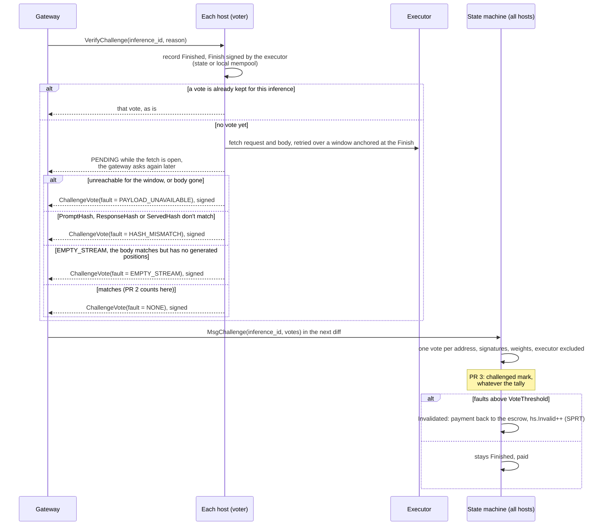
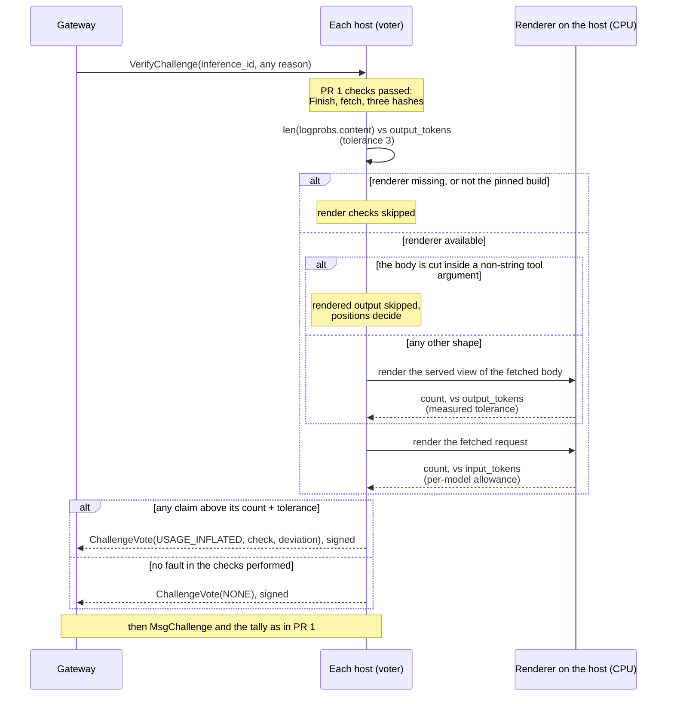

  <h1 class="issues-detail-title">
    <svg viewBox="0 0 16 16"><path d="M8 9.5a1.5 1.5 0 1 0 0-3 1.5 1.5 0 0 0 0 3Z"/><path d="M8 0a8 8 0 1 1 0 16A8 8 0 0 1 8 0ZM1.5 8a6.5 6.5 0 1 0 13 0 6.5 6.5 0 0 0-13 0Z"/></svg>
    devshard: executor-reported output tokens set the payment and are checked only on sampled replays
    #2000
  </h1>
  

    Open
    <a href="https://github.com/vitaly-andr">@vitaly-andr</a> opened 2026-10-14 09:11 UTC
    4 comments
    Updated 2026-10-24 07:28 UTC
  

  

**TL;DR**

1. The executor signs `input_tokens` and `output_tokens` in `MsgFinishInference` (the Finish below), and the group's state machine pays from them, capped only on their combined cost. Nothing checks either count unless a validator's own sampling picks the inference for replay, a re-run on the validator's MLNode.
2. A short answer can be billed at x11 under the current `max_tokens` cap and x27 under the join template default; the multiplier grows if the caps go up.
3. Three PRs in sequence. PR 1: a challenge the gateway starts and the escrow's hosts (the voters below) settle without an MLNode, on the body fetched from the executor. PR 2: two more triggers, a claim above twice the bytes on the gateway's side of the wire, and the count itself, done by the voters on a CPU. PR 3: a challenged inference is replayed more often, whatever the voters decided.
4. What stays with replay: inflation under the bounds, and a stored body made up to match its claim.

### Payment trusts the executor's counts until replay

`ActualCost = tokenCost(input, output, price)`, capped at the reservation (`state/machine.go:42`, `applyFinishInference` at `:1328`, the cap at `:1398`). The cap is on the sum, so each count is trusted separately. The gateway checks the stream against `ServedHash` but not the count. Replay compares both counts (`TokenCountInflated`, more than 3 tokens over, `common/validation/validation.go:181`, applied to output and input at `:443-450`), and runs only when a host's own sampling picks the inference. The chain default sampling rate is 1000 basis points, weighted by slots.

Take a 350-byte request with about 90 honest input tokens and 300 honest output tokens. The reservation counts the body in bytes, so an executor that reports `InputTokens = 350` and `OutputTokens = max_tokens` is paid the whole reservation, `(350 + max_tokens) × price`, against an honest `(90 + 300) × price`:

| `max_tokens` | where it comes from | paid vs. honest | output claim vs. the output bound (about 1,400 bytes received) |
|---|---|---|---|
| 4,096 | `RequestMaxTokensCap`, the cap on an explicit `max_tokens` (`devshardctl/gateway.go:252`) | x11 | 4,096 > 2,800, challenged |
| 10,000 | `GATEWAY_DEFAULT_MAX_TOKENS` in the join template, used when a request has no `max_tokens` | x27 | challenged |

The input side of the example, `InputTokens = 350`, is one token per request byte and passes any byte bound; what it can take is bounded by the request's bytes, about x4 of the honest input here, and that is what stays for replay.

Higher caps: x85 and x337

| `max_tokens` | where it comes from | paid vs. honest | output claim vs. the output bound |
|---|---|---|---|
| 32,768 | the lowest output limit any OpenRouter provider sets for DeepSeek-V4-Flash-0731 | x85 | challenged |
| 131,072 | the output limit Z.AI and MiniMax set for GLM-5.3-Flash and MiniMax-M2.7 on OpenRouter | x337 | challenged |

Rows above 4,096 need a raised `GATEWAY_MAX_TOKENS_CAP` for an explicit `max_tokens`, or a higher `GATEWAY_DEFAULT_MAX_TOKENS`: the default is not capped (`capOutputTokens`, `devshardctl/request_filters.go:321-330`). Every OpenRouter provider of these models allows more than 10,000.

A catch on replay costs the executor that payment and one `Invalid`, which feeds the invalidation SPRT; a participant marked INVALID loses collateral and is removed from groups. That deters a host that inflates often. One that inflates a small share can stay under the SPRT. Take 100 answers worth 1 each, 10 of them inflated at x337, with the chain default sampling:

#1757 and #1794 (both open) change what the SPRT counts as a pass, not this arithmetic. #1763 (draft) lowers the ceiling to the model's context, and the claim below it stays unchecked.

### After #2003, a cut stream and a full Finish are normal

#2003 runs the normal execution path detached from the request (`transport/inference.go:219-222`, `host/host.go:1267-1270`), and the proxy reads the stream to the end after the client leaves (`cmd/devshardd/inference/proxy.go:95`). An honest host now signs a full Finish after a cut, and the Finish reaches the gateway from the executor's mempool on its next response (`user/session.go:1195-1208`). So the gateway can't treat "I received less than you claim" as a fault on its own, with or without #1574. Execution or storage can still fail, so a Finish isn't guaranteed either.

### What starts a challenge

The gateway counts no tokens and fetches nothing. It knows the bytes of the request it sent and the bytes of the text it received, and it already knows whether the stream binds to the Finish. One formula for both counts: a claim is challenged when it is above `F × (bytes + allowance)`, with F = 2. For the output the bytes are the text received and the allowance is a few bytes for special tokens, the longest `stop` entry and the tool-call markup; for the input the bytes are the request's and the allowance is what the chat template adds. Below, "the output bound" and "the input bound" mean these two. The gateway challenges in three cases:

1. **The stream doesn't bind to the Finish (PR 1).** Either it was cut before `[DONE]`, or it was complete and the hash the gateway computed over it matches neither hash the Finish carries: `ServedHash` for a stream with logprobs stripped, `ResponseHash` when the client asked for logprobs and the executor forwarded its stored copy as is (`judgeServedBinding`, `user/served_binding.go:119-126`, the check the gateway runs today). That check sees complete streams only: if the stream ends before both `[DONE]` and `devshard_meta`, `Sums` returns no hashes (`common/completionapi/served_projection.go:86-89`) and `BindReceivedStream` records nothing (`user/served_binding.go:41-42`). PR 1 has to keep such a cut until its Finish arrives, leaving out the cuts the gateway made itself. After #2003 a cut followed by a full Finish is normal for an honest host, and the gateway holds no signed body, so only the voters can settle it. Today a mismatch is only a local strike against the host (`devshardctl/served_binding.go:23-40`). What the voters can settle on a cut stream is the body's consistency with the Finish: that it exists, hashes to what was signed, and its counts match. They can't see what the gateway received, so an executor that streams a short text, cuts, and stores a different, self-consistent long body passes them. That case gets a raised replay probability instead (PR 3). In this design the request carries the inference id and the signed session diffs, but no stream or body the gateway observed: the executor's signed Finish is what the stored body is held against.
2. **`output_tokens` above the output bound (added in PR 2).** Every token except special ones like EOS decodes to at least one byte of text (the one other exception is a byte-fragment token of a broken UTF-8 sequence that the detokenizer drops; the vocabulary counts are in the measurements below, and F = 2 covers them), so an honest `output_tokens` can't exceed the bytes of text the gateway received plus the allowance: a few bytes for the special tokens, the longest `stop` entry in the request (cut from the text but counted) and the model's tool-call markup. The text is every string field of `delta` on choice 0 except known metadata: `content`, the reasoning field under whichever name the engine build gives it (`reasoning` or `reasoning_content`), `tool_calls[].function.name` and `.arguments`, decoded as UTF-8, not JSON-escaped. A stream padded with lines that carry no content adds no bytes, so it fails here.
3. **`input_tokens` above the input bound (added in PR 2).** The request's bytes are the raw JSON, never shorter than the text the chat template renders from it, so the bytes cover the messages and the allowance covers what the template adds: its own tokens and the default system prompt. The allowance depends on what the request carries, since the template renders `tools`, `response_format` and the reasoning settings its own way (the tools block alone is about 1 KB of template text on the models measured), and on tool calls in the history, which the template renders as the engine saw them; it is measured per model, like the output tolerances. Input and output have one price (`tokenCost`, `state/machine.go:42-51`), so without this bound an executor would report an honest output and move the rest of the reservation into the input.

Where this sits in the gateway:

1. The bytes are counted on the lines the gateway already forwards, in the pass it already makes: every forwarded event goes through `raceWriter.Write` into `scanSSEChunk` (`devshardctl/redundancy.go:1779-1781`, `sse_chunk.go:46-75`), and the count reads the `delta` fields there, so it costs no second decode and needs neither a model nor a tokenizer. The raw line length won't do: one token travels in about 200 bytes of SSE JSON, so a bound on raw bytes would pass any claim, and padding lines would count.
2. The bounds are coarse on purpose, and F = 2 is why. No honest text is denser than one token per byte (the vocabularies have single-byte tokens; the special tokens are in the allowance), so F = 1 is already a bound and F = 2 is the working figure, a margin of two. In tokens that means about x10 for English prose at 4.8 bytes a token, x3 for hex and base64 at 1.5. Bytes can't decide anything finer, and they don't have to: the bound only picks what goes to the voters and never rejects a claim by itself. Inflation under the bound stays with replay, as today.

Gateway cases: the counts wait for the Finish, a client that leaves, the gateway's own cancel, tool calls, images

1. The counts wait for the Finish next to the stream hashes (a cut stream's too, once PR 1 keeps it), which already wait for it with a retention of twice the execution timeout (`waitingReceivedStream`, `user/served_binding.go`), because the Finish may arrive later through the executor's mempool.
2. A client that leaves isn't a cut. After the client disconnects the gateway reads the executor's stream to `devshard_meta`, for up to 40 minutes (`DEVSHARD_META_DRAIN_TIMEOUT_SECONDS`, `devshardctl/proxy.go:36-42`, `withMetaDrain` at `:129`). A cut at the gateway is the executor's or the network's.
3. A cut the gateway made itself isn't one either: a losing speculative attempt cancelled past `SecondaryWaitAfterWinner` may sign an honest Finish later, and it is not challenged.
4. Tool calls are not a special case at the gateway. An honest output cut by `max_tokens` inside a non-string tool argument has no byte bound: the engine's parser holds the value back and drops it on the cut, so the claim can be far above the served bytes. The gateway challenges it like any other claim above the bound, and the voters settle it exactly by positions, which the parser never touches (it only splits text, and with `return_token_ids` every chunk is kept). The honest host passes, at the price of one fetch and one count. Excluding the shape at the gateway would hand an inflating executor a free pass, since `finish_reason` and the claim are both its own.
5. Images are. A request with non-text parts such as `image_url` passes request validation (`common/completionapi/request.go:134-140`), and image tokens aren't bounded by the URL's bytes, so the input bound doesn't apply to it. Today's models are text-only and the engine refuses such a request, so there is no Finish to inflate; for a vision model the input of such requests stays with replay, which counts the prompt on the GPU. The output bound applies to them as to any answer.

### PR 1: the challenge protocol

The shape already exists: `MsgErrorMiss` (#1652) is a gateway-started verdict on a Finished inference that no MLNode touches. The gateway asks every host over an RPC, each host checks the evidence locally and returns a signed vote, the gateway puts the votes into one tx in its next diff, and the state machine counts them above `VoteThreshold` (`VerifyErrorMiss`, `host/timeout.go:416-470`; `applyErrorMiss`, `state/machine.go:1670-1735`; `MsgErrorMiss`, `proto/devshard/v1/tx.proto:67-76`). PR 1 adds the same path with a different question and a different outcome. Working names:

1. **RPC `VerifyChallenge`** on `SessionService` next to `VerifyErrorMiss` (`proto/devshard/transport/v1/session.proto:157`). The request carries `inference_id`, the gateway's `reason` (`STREAM_UNBOUND` and `EMPTY_STREAM` in PR 1; the byte bounds come with PR 2), and the diffs a cold or lagging host needs to open the session and see the Finish, as `VerifyErrorMiss` takes them (`bindStartProof`, `transport/rpcserver/session.go:363`). The escrow creator signs the diffs; the executor separately signs the receipt and the Finish they carry. The gateway adds no body and no evidence of its own. The host answers with a signed `ChallengeVote`.
2. **Fetch and verify hashes.** As in `VerifyErrorMiss`: the record is Finished, the Finish is in the state or in the local mempool and carries the executor's signature. Then, unlike `VerifyErrorMiss`, the host fetches the request and the body from the executor, the way replay validators already get them (`fetchPayloadsFromExecutor`, `cmd/devshardd/inference/validate.go:91`; the voter is a group member, which is what the executor checks, `session/manager.go:1891-1894`), retrying over a window, and checks the three hashes as replay does (`verifyFetchedPayloadHashes`, `validate.go:166-177`: prompt against `PromptHash`, body against `ResponseHash`, the body with logprobs stripped against `ServedHash`). Nothing in this path calls a model.
3. **Signed vote.** `ChallengeVoteContent{escrow_id, inference_id, fault, check, deviation, response_hash}`, signed under its own domain tag like `ErrorMissVoteContent` (`diff.proto:124-131`), so a vote can't be replayed as another kind. `fault` is an enum, not a bool: `NONE`, `PAYLOAD_UNAVAILABLE`, `HASH_MISMATCH`, `EMPTY_STREAM`, and from PR 2 `USAGE_INFLATED`. A vote with `NONE` is a valid vote: it says the checks this host could run found no fault, and nothing about a check it skipped. `check` names the test that failed (hash, positions, rendered output, rendered input) and `deviation` is the claim minus the count, both inside the signed content, so the diff log shows by how much and on which check an executor lost a payment, and a vote can't be reused with another story.
4. **`MsgChallenge{inference_id, votes[]}`**, a new `DevshardTx` oneof member after `error_miss = 14` (`diff.proto:40`). Applied like `applyErrorMiss`: Finished only, one vote per address, signature recovered and matched to the slot, weight by slot count. The executor's own slots don't vote, and the state machine refuses them itself: `applyErrorMiss` leaves that to the gateway today (`user/session.go:4672`), which this design doesn't trust (#1573). Faults of any kind are summed into one tally, since each says the executor's claim doesn't hold; above `VoteThreshold` the record turns Invalidated with the effects a replay invalidation has: `Balance += ActualCost`, `hs.Invalid++`, `hs.Cost -= ActualCost` (`state/machine.go:1493-1503`). That code acts on Challenged records only (`resolveChallengeTalliesLocked`, `:1489`), so the transition from Finished is a new one. Below the threshold the record stays Finished and paid; the tx is still applied, so the votes are on the diff log and PR 3 can act on them. An executor holding half the slots or more leaves the rest unable to reach the threshold, so no challenge against it can pass; `MsgErrorMiss` has the same limit today.

PR 1 in detail: votes over RPC, limits, fetch faults, the seal, one verdict per inference, versioning, settlement, reuse, observability, no Finish at all

1. **Why RPC votes, not votes in the hosts' mempools.** Hosts' mempool txs reach the state only with the diffs the gateway writes when it has traffic. Collected over RPC, the votes ride in the gateway's next diff, like `MsgErrorMiss`, so a quiet escrow still settles the challenge.
2. **Limits.** The gateway isn't trusted, so a cap on its side limits nothing; what protects the hosts from a gateway that challenges everything is their own per-peer RPC budget, which already exists: `VerifyChallenge` gets `RPCWeightVerify` like `VerifyTimeout` and `VerifyErrorMiss` (`transport/rpc_weights.go:33-35`; 6,000 weight a minute per peer, `transport/rpc_limits.go:15`), plus the one verdict per inference below. A challenge by itself costs the executor nothing and can't hurt an honest host: its only effects are the voters' fetch and count, and, with PR 3, the raised replay probability. Making a challenge cost the gateway something (a fee, a stake, a budget in the escrow) is out of scope here.
3. **When a failed fetch is the executor's fault.** The replay path already has the rules, and the voters reuse them (`executorFaultVerdict`, `cmd/devshardd/inference/validator.go:260-300`; `classifyPayloadFetchError`, `validate.go:286-308`): a body reported gone is a fault only while the escrow's epoch is inside the executor's retention (phase at most the escrow epoch plus one), later it is an honest prune. A body too large is a fault. A peer not ready is retried, not a fault. One difference from replay: on a challenge the whole group fetches the same body right after the Finish, not spread out as sampling is, so a 429 inside the window isn't a fault here, while replay counts it after one retry. The window also has to outlast an executor restart: minutes rather than one attempt, as a parameter. With a short window a deploy would turn every open challenge into a `PAYLOAD_UNAVAILABLE` tally at once, a burst of `Invalid` for an honest host. A host whose own network dropped both cuts the stream and fails the fetch, so the window has to outlast its reconnect too.
4. **The seal.** A Finished record is sealed once `stateClock - ConfirmedAt` reaches `InferenceSealGraceSeconds + ExecutionTimeout` (`state/seal.go:619-621`; the chain default for the grace is 3,600 s, `inference-chain/x/inference/types/params.go:144`), and `applyErrorMiss` rejects a sealed inference (`state/machine.go:1673`). `MsgChallenge` does the same. So the fetch window plus the diff interval has to stay under `InferenceSealGraceSeconds`, which minutes against an hour do; the challenge never holds the seal, since a gateway must not be able to keep records live on its own. The raised replay probability of PR 3 works while the record is live, as sampling does today.
5. **One verdict per inference.** A host fetches and counts once per inference and keeps the signed vote; a repeated `VerifyChallenge` for the same inference gets the same vote back, so a gateway can't make the group refetch, and can't collect vote sets until one of them crosses the threshold. The fetch window is anchored at the Finish, not at the gateway's request, so a late challenge doesn't reopen it. The window is minutes while one verify RPC is bounded by the peer client's 3 m `VerifyTimeout` (`transport/client.go:311`), so `VerifyChallenge` answers `PENDING` until the host's fetch settles, and the gateway asks again later; the kept verdict makes the repeat cheap. In the state machine a `MsgChallenge` below the threshold is applied, not rejected as `applyErrorMiss` rejects an insufficient `MsgErrorMiss` (`ErrInsufficientVotes`): the votes stay on the diff log, and in PR 3 the mark is its effect. A second `MsgChallenge` for the same inference is applied as a no-op. This is apart from the seal: the gateway delays the escrow's settlement while a challenge waits for its vote tx, since `escrowHasBackgroundWork` (`devshardctl/gateway.go:173-176`) tracks only active requests and race cleanup today, and the drain would settle the still Finished record with its payment intact.
6. **Protocol version.** A new tx type and RPC change the state root, so this ships as a new `DevshardStateRootAndProtocolVersion` (`types/domain.go:12`, `v6` today) and a new approved version on chain. Sessions bind to a version path (`/devshard/{version}/sessions/...`, `docs/upgrade.md`), so a `v6` host never sees `MsgChallenge`, and an escrow runs on one version. The escrow creator picks the version by the path of its first request (`docs/upgrade.md`), so the protection covers the escrows whose payer chose the new version, and a host on another protocol binary refuses to sign for them.
7. **Settlement.** `DevshardSettlementHostStats` has `invalid` (`inference-chain/proto/.../devshard_escrow.proto:42`) and the SPRT reads it as today: an `Invalid` from a challenge is a failure of the same weight as one from a replay. A `NONE` verdict adds nothing: it checks the count on a CPU, not the answer, and it must not count as a pass, or a gateway in league with an executor could challenge everything it serves and fill `validated` without an MLNode (with #1757 and #1794 the passes come from sampled replays only, capped by the sampling rate). PR 1 doesn't change the chain proto; a per-fault counter can be added later if the SPRT should weigh them differently.
8. **Reuse.** Empty-stream detection (#1841, #1823; PR A of #2043 covers the same case as a `MsgErrorMiss` verifier rule) is a `VerifyChallenge` with its own reason, `EMPTY_STREAM`: a receipt the executor signed, then a stream that ended with no content. The voters already hold the receipt: the state applies `MsgConfirmStart` only over the executor's signature (`checkReceiptLocked`, `state/machine.go:1268`), and a Finish applies only to a Started record (`state/machine.go:1336`), so an applied signed Finish proves the receipt came first. The signature itself stays in the diff log, not in `InferenceRecord`. The voters' rule is the same fetch: a body unavailable for the whole window is `PAYLOAD_UNAVAILABLE` as above, a fetched body that matches its hashes but has no content either is `EMPTY_STREAM`, and the vote is `NONE` when the executor holds a real body (then the gateway's stream was cut; with PR 3 the raised replay probability applies). Content here means the generated `logprobs.content` positions retained in the stored body, not decoded text: an honest answer can decode to nothing, for example under a client's `logit_bias` of +100 on a byte-fragment token (see the comments below).
9. **Observability.** The gateway counts challenges by reason and executor, and the share that ended `NONE`, which is its false-challenge rate. A Finish that arrives after the gateway's retention window (`waitingReceivedStream`, twice the execution timeout plus the buffer, kept in memory and lost on a gateway restart) is logged as unchecked rather than left to stand silently. The voters count votes by fault and renderer abstentions. The chain can tell a challenge `Invalid` from a replay `Invalid` only with the per-fault counter above.

Only a Finished inference can be challenged. If the connection drops and no Finish ever arrives, the inference ends on the timeout path as today (`TIMEOUT_REASON_EXECUTION` from Started, `TIMEOUT_REASON_REFUSED` from Pending, `state/machine.go:1596-1606`), and nothing is paid, so there is no count to dispute. The exception is a record still Started at the session's drain: it is settled at its full reservation with no Finish at all (`settleLiveRecordLocked`, `state/machine.go:1761-1772`), which is what #2064 is about; a challenge can't reach it either, since there is no Finish to hold the executor to. If the Finish arrives later through the executor's mempool, it brings the executor's own `MsgConfirmStart` with it (`host/host.go:1024-1035`), and the challenge works as in the cut rows above.

### PR 2: the count

PR 2 adds the two byte bounds to the gateway as reasons (`OUTPUT_ABOVE_BYTES`, `INPUT_ABOVE_BYTES`) and the counting to the host's `VerifyChallenge` check, between the hash check and the vote. The host counts on every challenge, whatever the reason: a cut stream with a sound body and an inflated claim is caught here too.

1. **Positions**, exact. The stored body keeps one logprobs position per generated token, even when the executor strips them for the gateway (`cmd/devshardd/inference/execute.go:115`, `:138`; `common/completionapi/responseprocessor.go:115-136`). `len(logprobs.content)` against `output_tokens` with a tolerance of 3, counted directly rather than through `GetEnforcedTokens`, which skips a position without `top_logprobs` (`common/completionapi/completionresponse.go:111`) and would come out short for an honest executor.
2. **Rendered output.** The served view of the body goes through the model's renderer and the count is compared with `output_tokens` within a measured tolerance: a fixed part for EOS and reasoning markers, the longest `stop` entry when the request has `stop`, the model's tool-call markup per call and per argument present in the body, and a relative part for a sampled text that re-tokenizes shorter than the model emitted it (whitespace runs, repeated characters). This catches a body whose positions were made up to match a short text. For the cut inside a non-string tool argument the renderer abstains and positions decide.
3. **Rendered input.** One render call on the request gives the input count, compared with `input_tokens` within the per-model allowance. The renderer has to be the pinned build for the model: a voter without a working renderer, or on another build, abstains on the render parts and still votes on positions.
4. Any of the three above its threshold: `fault = USAGE_INFLATED`, with the check and the deviation in the vote.
5. Measured so far: the gap table below, on three models. Still to measure before PR 2, on the builds the hosts run: F, the relative part of the output tolerance, and the input allowance per model.

PR 2 in detail: the renderer build per model, and the measurements behind the thresholds

**The renderer** is `vllm launch render {model}` on the voter: the tokenizer and the chat template, without weights or a GPU. It has to be the build the hosts run. MiniMax-M2.7 and DeepSeek-V4-Flash hosts run the Gonka vLLM fork at 0.25.1, which changes neither parsers, templates nor tokenizers, so the stock CPU image counts the same. GLM-5.3-Flash hosts run the fork's `release/v0.28.0-glm53`, which stock vLLM doesn't support and which has no CPU build: the fork's `Dockerfile.cpu` needs `TARGETARCH` declared in the `triton-cpu` stage, and `vllm launch render` needs prefix caching off on CPU. I have both fixes; they go with PR 2. A host whose renderer is down still votes on positions and abstains on the render parts. The renderer build is pinned per model next to the engine build the hosts run, and a voter whose renderer is another build abstains on the render parts rather than voting with it: replay already exempts a 78-79 token input gap between two DeepSeek-V4-Flash formatter versions (`handleDeepSeekFormatterException`, `common/validation/validation.go`), and with the input checked on every challenge a split like that would be a wave of `USAGE_INFLATED` on whoever updated first or last. A chat template update ships with the renderer build; until it does, the input check is off for that model. The input tolerance is per model, measured like the output one.

CPU per check with the renderer, three render calls (the request, the served assistant turn, and an empty assistant turn whose count is the template's own tokens, subtracted from the served turn), counted from the render server's processes:

| Model | Short answer (101-179 input, 316-348 output tokens) | Long answer (6.8-7.7k input, 2.1-2.3k output) | Memory |
|---|---|---|---|
| DeepSeek-V4-Flash, vLLM 0.28.0 | 2.5-2.8 ms | 12.4-14.3 ms | 1.3-1.5 GB |
| MiniMax-M2.7, vLLM 0.28.0 | 3.3-4.0 ms | 13.1-14.1 ms | 1.2 GB |
| GLM-5.3-Flash, Gonka vLLM fork | 3.1-3.3 ms | 11.3-13.0 ms | 5.6 GB |

False positives of the voters' render. The renderer sees text, not token ids, so the rendered count can differ from an honest claim. I checked the cases offline, with no weights and no GPU, on DeepSeek-V4-Flash and MiniMax-M2.7 (stock CPU images of vLLM 0.25.1 and 0.28.0, which give the same results; DeepSeek-V4-Flash on 0.25.1 is one token lower throughout) and GLM-5.3-Flash (a CPU build of the Gonka vLLM fork the GLM hosts run). "Gap" is the claim minus the count.

How the cases were built: the generated output is the model's own chat template rendering of an assistant turn, served through vLLM's real parsers (the `Parser.parse_delta` path, with `finished` on the last token), and counted with `/v1/chat/completions/render` for the whole served turn. Stop strings go through vLLM's own stop check (`check_stop_strings`) on the decoded text. For the cut cases I cut the output at every position.

| Case | Status | Gap seen | Limit | Tolerance part |
|---|---|---|---|---|
| Full answer (EOS is counted but not in the text) | in the tolerance | +2 on all three models | constant | fixed allowance of 8 tokens |
| Stop string: its tokens are counted, the text is cut before it | in the tolerance | the stop string's tokens, plus -3 to +4 | the longest `stop` entry (the gateway allows 16 entries of 256 bytes) | the token count of the longest `stop` entry of the request, when it has one |
| Cut by `max_tokens` outside a tool call | in the tolerance | -1 to +3 | constant | the fixed allowance |
| Cut inside the opening tool-call markup, before the function name | in the tolerance | up to +14 (DeepSeek), +9 (MiniMax), 0 (GLM) | the length of the markup header | per-model allowance, per call present in the body |
| Cut inside a string argument (schema type exactly `string`) | in the tolerance | within +8 after the JSON is repaired | small: the parser streams strings as they are generated | the fixed allowance |
| Tool call the renderer can't take even after repair: `arguments` not JSON, a JSON array, an object instead of a string, no `function` | handled by a rule | no count at all | n/a | a fault, not a gap: the vLLM parsers for these three models build `arguments` with `json.dumps` of a dict (`vllm/parser/deepseek_v4.py`, `minimax_m2.py`, `glm47_moe.py`), so an honest host can't produce it. Rechecked for every model added |
| Non-streamed upstream: the parser drops the tail of an unfinished call | handled by a rule | the dropped tail | unbounded, up to `max_tokens` | the output bound applies only to answers the gateway received as a stream, which is its default |
| `skip_special_tokens` | handled by a rule | 0: same counts with `true` and `false` | n/a | none needed; the tool and reasoning markup is not in `all_special_tokens` |
| Renderer build differs from the host's engine | handled by a rule | any, input included: replay already exempts a 78-79 token input gap between old and new DeepSeek-V4-Flash formatters (`handleDeepSeekFormatterException`, `common/validation/validation.go`) | unbounded | the renderer build pinned per model; a voter on another build abstains on the render parts |
| Cut inside any other argument (object, array, number, or a string that may be null) | handled by a rule | grows by one per token; +23 to +24 on a 24-token object | unbounded, up to `max_tokens` | none: the parser holds the value back and drops it on a cut, so the renderer abstains on this shape and positions decide |
| Non-canonical tokenization during sampling | open | grows with length | not measured | the relative part of the tolerance, to be set from logged traffic before PR 2 |
| Constrained decoding (`response_format`, guided JSON) | open | grows with length | not measured | the same relative part, maybe its own, measured before PR 2 |
| Vocabulary entries that decode to nothing on their own (byte fragments, specials) | gateway side | 50 of MiniMax-M2.7's 200,054, 1,230 of DeepSeek-V4-Flash's 129,280, 18 of GLM-5.3-Flash's 154,856 | n/a | covered by F = 2 at the gateway |

One `stop` entry of 256 bytes is 19-55 tokens of English or Russian words, around 100 of Cyrillic without spaces and up to 238 of random characters.

Put together, the tolerance for an output claim is 8 tokens, plus the token count of the longest `stop` entry when the request has one, plus the model's tool-call header per call present (14 for DeepSeek-V4-Flash, 9 for MiniMax-M2.7, 0 for GLM-5.3-Flash), plus a relative part to be set from logged traffic. The cut inside a non-string argument is outside it: there the renderer abstains and positions decide.

### PR 3: a challenged inference is replayed more often

PR 1 settles what the voters can check and PR 2 adds the count. What neither reaches, a stored body made up to match its claim or a tool-call cut the voters had to pass, gets to an MLNode only on a validator's own sampling. PR 3 makes a challenged inference more likely to be picked, without forcing any host.

1. **Challenged mark.** `MsgChallenge` marks the record, a new field, whatever the tally; a second `MsgChallenge` for a marked record is applied as a no-op. The mark is not the `Challenged` status, which this design doesn't use.
2. **`ChallengedValidationRate`.** Sampling is per host: each host draws `deterministicHash(seed, inference_id)` with its own seed and compares it with `ValidationRate` (`ShouldValidate`, `state/validation.go:80-89`; the seed is derived from the host's signer and the escrow, `host/host.go:176`), so the executor can't tell who will replay. For a record with the challenged mark the predicate uses a higher rate, `ChallengedValidationRate`, a new session config field in basis points next to `ValidationRate` (`types/domain.go:149`). Each host rechecks the same hash against the higher threshold, so the hosts that already owed the replay keep owing it and more join: at the chain default of 10% a rate of 50% would make a challenged inference five times as likely to be replayed. The value is open. The owed set is maintained at each record write (`installOwedValidations`, `host/host.go:306-318`), and applying `MsgChallenge` is such a write. This is how a cut stream with a self-consistent stored body, or a tool-call cut the voters had to pass, still gets to an MLNode more often than an unchallenged inference, without any host being forced.
3. **Why not `Challenged`.** That status makes every host owe a replay (`OwedValidation`, `state/validation.go:107-109`), which is the MLNode path on every host at once. A mandatory replay still starts only from a validator's own signed invalid vote; a gateway signal only moves the odds.

### What each case comes to

An honest executor never loses a payment. The gateway's bound sits at twice the bytes, so an honest claim is challenged in one case only, and there the voters confirm it.

| Honest executor | Gateway | Voters | Payment | Replay |
|---|---|---|---|---|
| full stream | both claims within their bounds, stream bound | not called | stands | sampled |
| stream cut by the network (normal after #2003) | stream not bound to the Finish (STREAM_UNBOUND), the Finish arrives on the diff | hashes match, counts match | stands | raised (PR 3) |
| the stream to the gateway empty, the body holds the answer | receipt applied, empty stream (EMPTY_STREAM) | the body has generated positions | stands | raised (PR 3) |
| cut by `max_tokens` inside a non-string tool argument | output claim above the output bound | positions match the claim, render skipped | stands | raised (PR 3) |

An executor that inflates loses the payment and takes an Invalid when a check reaches the claim. What no check reaches stays for replay, with a raised probability (PR 3) where the gateway saw a signal.

| Inflating executor | Gateway | Voters | Payment / Invalid | Replay |
|---|---|---|---|---|
| inflated `output_tokens`, full stream or padded with empty lines | output claim above the output bound | positions and rendered output below the claim | lost, `hs.Invalid++` | none, the record is terminal |
| honest output, the rest of the reservation moved into `input_tokens` | input claim above the input bound | rendered input below the claim | lost, `hs.Invalid++` | none, the record is terminal |
| signs the receipt, streams nothing, stores no answer | receipt applied, empty stream (EMPTY_STREAM) | no body for the whole window (`PAYLOAD_UNAVAILABLE`), or a matching body with no generated positions (`EMPTY_STREAM`) | lost, `hs.Invalid++` | none, the record is terminal |
| cuts, or streams one text and signs another, then withholds the body | stream not bound to the Finish (STREAM_UNBOUND), the Finish arrives on the diff | nothing for the whole window | lost, `hs.Invalid++` | none, the record is terminal |
| cuts and stores a body that isn't the signed one | stream not bound to the Finish (STREAM_UNBOUND), the Finish arrives on the diff | hashes don't match | lost, `hs.Invalid++` | none, the record is terminal |
| streams a short text, cuts, stores a self-consistent long body and signs it | stream not bound to the Finish (STREAM_UNBOUND), the Finish arrives on the diff | hashes match, counts match the stored body | stands | raised (PR 3) |
| inflation under the byte bounds | within the bounds | not called | stands | sampled |
| made-up long text with positions to match, including a real answer padded with whitespace or filler that the renderer counts honestly | within the bounds | not called; would pass if challenged | stands | sampled |
| inflated input on a request with image parts (a vision model, none today) | input bound not applied | the input render can't count images | stands | sampled |

Two different scales, then. The gateway's bound is loose, so only clear inflation costs the voters work. The voters' tolerances are tight: 3 tokens on positions (as `TokenCountInflated`), and the measured render tolerance. F and the tolerances are checked on the engines the hosts run before PR 2; a false challenge costs the voters a fetch and a count, never the executor a payment.

Related issues and PRs

- #1444: reject under-reported accounting on the host (a-kuprin, merged)
- #1466: better devshardd inference handling (a-kuprin, open)
- #1573: the executor can vote in its own challenge (iceiceic3, open)
- #1574: same-nonce stream reconnect and host ML drain (a-kuprin, open)
- #1652: streamed host and ML errors as misses, `MsgErrorMiss` (a-kuprin, merged)
- #1757: count only sampled passes in the invalidation SPRT (zpoken, open)
- #1763: cap the reservation at the model's `max_model_len` (qdanik, draft)
- #1794: SPRT pass counts per protocol version (a-kuprin, open)
- #1808: per-chunk stream signatures (tcharchian, open)
- #1823: under PoC challenge load the host returns an empty stream (tcharchian, open)
- #1829: signed `served_hash` in Finish (qdanik, merged)
- #1841: stream chunk signatures and empty-stream detection (tcharchian, open)
- #2003: queued diff writes; execution survives a cut (a-kuprin, merged)
- #2043: signed stream checkpoints and empty-stream misses, proposal (Ryanchen911, draft)
- #2064: bound the execution-timeout ChallengeReceipt by the verify budget (cyberdelamain, open)

@Ryanchen911, on open question 4 of #2043: the voters here get the inference id and the signed diffs they need to open or catch up with the session, but no stream or body the gateway observed. The receipt they do need, and an applied signed Finish proves that the executor's signed `MsgConfirmStart` was applied first; the signature itself stays in the diff log. The body is held against the signed Finish. So this design most likely has no use for signed chunks, and the empty-stream case of your PR A is the `EMPTY_STREAM` reason of PR 1 here.

@a-kuprin, this is the split you asked for. Please check that I have it right:

1. The protocol part is PR 1: the gateway starts a challenge with no invalid vote from a validator, and no step of it touches an MLNode. Anything that needs an MLNode still starts only from a validator's own signed invalid vote; PR 3 only moves the odds of that sampling for a challenged inference.
2. Token counting is PR 2, on top of PR 1, so PR 1 can be reused for empty-stream detection (#1841) as it is: the `EMPTY_STREAM` reason in the PR 1 details.
3. The count runs on the escrow's hosts, on a CPU, from the per-token positions the executor's MLNode already produced plus the model's own renderer; the gateway has no tokenizer and no extra load. The only thing left on the gateway is the byte count on the lines it already forwards, which is what starts a usage challenge in PR 2.

---

## 💬 Comments (4)

  

    <a href="https://github.com/cyberdelamain">@cyberdelamain</a>
    commented 2026-10-20 04:25 UTC
  

  

    
@vitaly-andr On PR 2's rendered-output check: a gateway client can make the voters return <code>USAGE_INFLATED</code> against an honest executor. #2043's latest revision now hands this case to #2000 ("The case this does not settle"), so it lands here.

The gateway passes <code>logit_bias</code> up to ±100 (<code>cmd/devshardctl/request_filters_parameters.go:453</code> on <code>devshard-0.2.x-v6</code> @ <code>3c924cbf6</code>). Put +100 on a single-byte fragment token, e.g. id 159 on DeepSeek-V4-Flash-0731 (byte 0xE0) or id 224 on MiniMax-M2.7 (GLM-5.3-Flash behaves the same), and every generated token is that fragment. The decoded text always ends in U+FFFD, so the detokenizer emits nothing (<code>vllm/v1/engine/detokenizer.py:211-247</code> in gonka-ai/vllm <code>befecf605</code>), and the final chunk doesn't flush it either. The honest answer is an empty text with <code>finish_reason: "length"</code> and <code>completion_tokens = max_tokens</code>. I checked the detokenizer with <code>tokenizers</code> 0.23.3 <code>DecodeStream</code> on the published <code>tokenizer.json</code>: 256 forced steps give 0 characters, the control gives 64.

On that answer the voters see:

<ul>
<li>positions: 256 against 256, no fault (<code>serving.py:731-738</code> still sends a chunk with logprobs when <code>return_token_ids</code> is set);</li>
<li>rendered output: an empty served turn, about 0 against 256, far above the 8-token tolerance, so step 4 votes <code>USAGE_INFLATED</code>, and the honest executor loses the payment and takes an <code>Invalid</code>.</li>
</ul>

The byte-fragment row of the gap table is marked "covered by F = 2 at the gateway". That holds for the share of fragments in ordinary text. Here the client sets the share, up to every token, and nothing covers it on the voter side.

A blanket skip for positions that decode to nothing would open the case PR 2 is meant to catch: an inflating host could pad a short answer with fragment ids in empty-content chunks, and positions, decoded text and render would all agree. Two narrower exemptions keep that closed. The stored body keeps an id at every position (<code>compressLogprobsIn</code> drops only <code>bytes</code> and <code>logprob</code>, and the fork returns ids as <code>token</code>). So the voter can take out of the render comparison only:

<ol>
<li>positions whose id carries a positive <code>logit_bias</code> in the request, which the voter already checks against <code>prompt_hash</code>, so a host can't add a bias the client didn't send;</li>
<li>an unfinished UTF-8 tail of at most 3 tokens, which the fixed tolerance already covers.</li>
</ol>

Positions that produce no text should be judged by running the ids through the engine's incremental detokenizer, not <code>tokenizer.decode</code>: <code>decode([159] * 256)</code> returns 256 U+FFFD characters, while the stream emits nothing.

  

  

    <a href="https://github.com/vitaly-andr">@vitaly-andr</a>
    commented 2026-10-20 07:47 UTC
  

  

    
@a-kuprin a question for PR 2: which vLLM build is the reference?

Hosts don't run one image. <code>hardware_nodes</code> for the epoch 430 members, nodes in <code>INFERENCE</code>:

<table>
<thead>
<tr>
<th>MLNode</th>
<th>vLLM code</th>
<th>nodes</th>
</tr>
</thead>
<tbody>
<tr>
<td>3.1.0, 3.1.0-post3</td>
<td>gonka-ai/vllm <code>71ee49c4d</code> (<code>release/v0.28.0-glm53</code>) on a 0.28 dev base</td>
<td>123</td>
</tr>
<tr>
<td>3.0.16</td>
<td>fork <code>6e9684a17</code> on vLLM 0.25.1</td>
<td>11</td>
</tr>
<tr>
<td>4.0.0-sigma1, 3.1.0-post3-pfrun0</td>
<td><code>release/v0.30-decode-int</code> on vLLM 0.30.0</td>
<td>15</td>
</tr>
<tr>
<td>3.0.14, 0.2.0, 3.0.16-spark-pilot</td>
<td>no such image on ghcr</td>
<td>15</td>
</tr>
</tbody>
</table>

I matched the vLLM files in each image's layers against the fork's commits by blob hash, and they are identical. <code>deploy/join</code> in main still defaults to 3.0.16. 3.1.0-post3 is documented only in #1734, and the chain pins neither the image nor the version.

The templates and parsers differ between these lines. DeepSeek-V4-Flash renders the same request without thinking by default on 0.25.1 and with thinking on 0.28. On 0.28, MiniMax-M2.7 with the chain's <code>--reasoning-parser minimax_m2_append_think</code> leaves the reasoning in <code>content</code>, which #1734 notes as well. The chain args take precedence over the node's, so operators can't change this. <code>docs/chat-api/deepseek-v4-flash-0731.md</code> on <code>decode-poc-int-0.2.16</code> already says that a mixed-build group disagrees on work nobody did wrong.

This corrects the issue text, which says MiniMax-M2.7 and DeepSeek-V4-Flash hosts run the fork at 0.25.1. Most of them run 3.1.0. The issue also says the renderer build is "pinned per model next to the engine build the hosts run", but nothing pins the engine build today, so there is nothing to pin the renderer next to.

Should the reference be the build most hosts run (3.1.0 today), or will the image be pinned per model on chain?

  

  

    <a href="https://github.com/vitaly-andr">@vitaly-andr</a>
    commented 2026-10-20 07:51 UTC
  

  

    
@cyberdelamain Thanks, confirmed. With <code>logit_bias</code> +100 on a single-byte fragment, the stream detokenizer emits nothing on all three models, so an honest empty answer would be voted <code>USAGE_INFLATED</code>. I'm preparing tests on fixtures built from the real tokenizers and parsers of the builds the hosts run. They will cover this case and others like it. Your review will be welcome when I open the PR.

  

  

    <a href="https://github.com/a-kuprin">@a-kuprin</a>
    commented 2026-10-24 07:28 UTC
  

  

    <blockquote>

4. a question for PR 2: which vLLM build is the reference?

</blockquote>

Every should be supported. I don't think we should limit users which vllm they use.

What is practical differences between them for these changes?

We force reasoning anyway

  

---

> 🔄 **Auto-synced** from [Issue #2000](https://github.com/gonka-ai/gonka/issues/2000) every hour.
