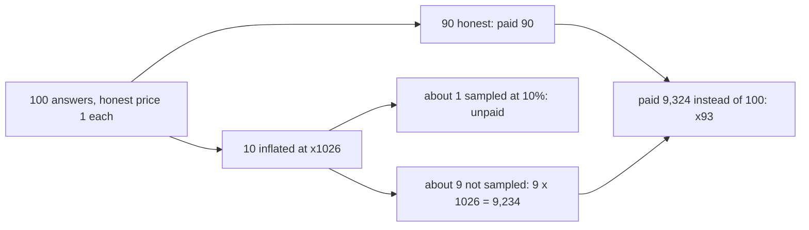
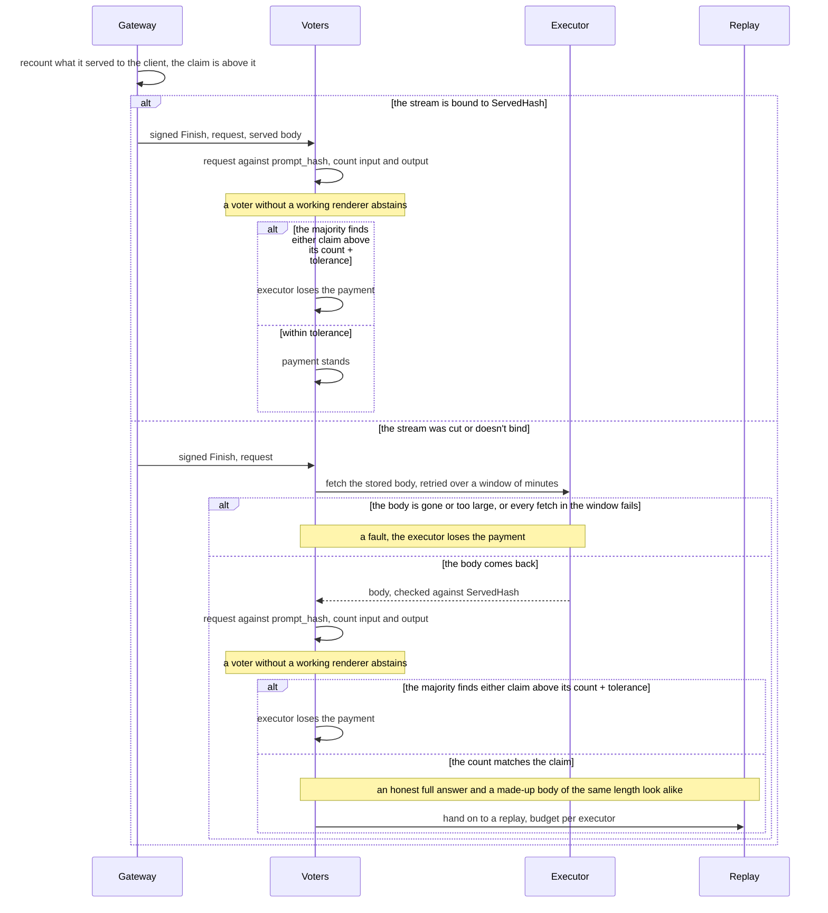

  <h1 class="issues-detail-title">
    <svg viewBox="0 0 16 16"><path d="M8 9.5a1.5 1.5 0 1 0 0-3 1.5 1.5 0 0 0 0 3Z"/><path d="M8 0a8 8 0 1 1 0 16A8 8 0 0 1 8 0ZM1.5 8a6.5 6.5 0 1 0 13 0 6.5 6.5 0 0 0-13 0Z"/></svg>
    devshard: executor-reported output tokens set the payment and are checked only on sampled replays
    #2000
  </h1>
  

    Open
    <a href="https://github.com/vitaly-andr">@vitaly-andr</a> opened 2026-10-14 09:11 UTC
    0 comments
    Updated 2026-10-14 09:11 UTC
  

  

**TL;DR**

- The executor signs `input_tokens` and `output_tokens` in `MsgFinishInference`, and the payment is taken from them, up to the reservation. Only a sampled replay (about 10%) ever compares them with the answer.
- A short answer can be billed at x11 under the current cap, x27 under the join template default, and up to x1026 at the model's context. Every OpenRouter provider of these models allows more output than Gonka's caps, so the caps will go up.
- Sampling doesn't make this unprofitable: a host that inflates 10% of its answers stays under the SPRT and earns about x93.
- Proposed fix (path 2): the gateway starts a count vote on CPU. Voters recount both the input and the served output with the model's renderer (no weights, no GPU, 2.5-14 ms of CPU per check); input matters too, since the state machine caps only the sum. If the stream was cut and the gateway holds no signed body, the voters fetch the stored body from the executor, as replay already does. An inflated claim gets no payment, and no other penalty is needed.
- Still open: a cut inside a non-string tool argument (options a/b/c below), CPU builds of the renderer, and replay for a made-up body that matches its claim.
- I'll start with path 2 and bring the protocol changes with a draft PR. @akup, before I start, I'd like to hear whether path 2 is a direction you'd accept, and what I've missed.

### What happens

The executor signs `input_tokens` and `output_tokens` in `MsgFinishInference`, and the state machine pays from them: `ActualCost = tokenCost(input, output, price)`, capped at the reservation (`state/machine.go:43`, `applyFinishInference` at `:1262`). Nothing compares `output_tokens` with the answer the client received. The gateway checks the stream against `ServedHash` (`user/served_binding.go`) but not the token count. Replay compares the count (`TokenCountInflated`, more than 3 tokens over, `common/validation/validation.go:181`), but only on sampled inferences.

On an inference that is not sampled, any `output_tokens` up to `max_tokens` gets paid. Take a short question: a 350-byte body, about 90 honest input tokens and 300 honest output tokens. The reservation counts the body in bytes, so an executor that reports `InputTokens = 350` (the byte count) and `OutputTokens = max_tokens` is paid the whole reservation, `(350 + max_tokens) × price`, against an honest `(90 + 300) × price`:

| `max_tokens` | where it comes from | paid vs. honest |
|---|---|---|
| 4,096 | `RequestMaxTokensCap`, the cap on an explicit `max_tokens` (`devshardctl/gateway.go:248`) | x11 |
| 10,000 | `GATEWAY_DEFAULT_MAX_TOKENS` in the join template, used when a request has no `max_tokens`; the cap does not apply to it | x27 |
| 32,768 | the lowest output limit any OpenRouter provider sets for DeepSeek-V4-Flash-0731 (most allow 384,000 or more) | x85 |
| 131,072 | the output limit Z.AI and MiniMax set for GLM-5.3-Flash and MiniMax-M2.7 on OpenRouter | x337 |
| 179,910 | MiniMax-M2.7 context (180,000) minus the prompt | x462 |
| 399,910 | GLM-5.3-Flash context (400,000) minus the prompt | x1026 |

Rows above 10,000 need a raised `GATEWAY_MAX_TOKENS_CAP` or the operator's admin key, which bypasses the cap. Every OpenRouter provider of these three models allows more than 10,000, so the caps are likely to go up, and the multiplier grows with them.

The existing checks don't cover this:

- #1444 rejects under-reported accounting, not over-reported.
- #1757 and #1794 (both open) make the invalidation SPRT count only sampled passes. Even with both merged and the flag on, a host that inflates a small share of its answers stays under the SPRT and keeps the money. Take 100 answers worth 1 each, 10 of them inflated at x1026, with 10% of answers sampled:

- #1763 (draft) would cap the reservation at the model's context length. That lowers the ceiling, but the claim below it stays unchecked.

### Paths I see

1. **Keep it statistical and raise the penalty**, for example a strike for an inflated count found on replay. The penalty has to be large. Today a catch costs the executor only that inference's payment (the invalidation refunds it), so at a 10% sampling rate inflating by more than about 11% already pays. To make it unprofitable, each catch has to cost about nine times the overpayment: for an answer billed at x1026, about 9,200 honest payments. The money is there, for example as a debt against the epoch reward, the way a negative `CoinBalance` is already recovered at settlement (`x/inference/keeper/bitcoin_rewards.go`). But a penalty that large has to be right every time: a false catch costs an honest host far more than it earned, so each disputed replay becomes a conflict.
2. **A count vote without GPU, started by the gateway.** It would work like `MsgErrorMiss` (#1652): the gateway sends the signed Finish, the request and the served body. The voters check the request against `prompt_hash` from Start and the body against `ServedHash` (#1829), then count input and output with the model's renderer on CPU. Both counts are needed: the state machine caps only the sum (`checkFinishLocked`, `state/machine.go:1306`), so an executor that reports an honest output and an inflated `input_tokens` still gets the whole reservation. If the majority finds either claim above its count by more than a tolerance, the executor loses the payment. That is the whole consequence: an inflated claim that the gateway can count earns nothing, so there is nothing to gain from it and no penalty to argue about, and an honest executor within the tolerance loses nothing. For voters to agree, the tolerance is a protocol constant per model, not a node setting. A voter that can't count, because it has no renderer for the model or the renderer fails, abstains. Each voter logs the claims it rejects, per gateway, so we can see how often gateways file false ones before deciding what to do about it.
3. **Paid validation on request.** The user or the gateway pays for a replay, optionally with a signed claim. This is the user-paid path in `VALIDATION_PROTOCOL_PROPOSAL.md`, and it covers more than token counts. I'm still working this one out and will follow up on it separately; it doesn't block path 2.

Path 2 step by step:

### Cost of the count in path 2

The count needs the model's tokenizer and chat template, not the model. `vllm launch render <model>` serves exactly that: `/tokenize` and `/v1/chat/completions/render`, no weights, no GPU, no network. It starts in 22-30 s. One check is three render calls: the request, a short chat ending in the served turn, and the same chat ending in an empty turn. The first gives the input count. The difference between the other two gives the output count, so the template's own tokens around the turn cancel out.

CPU per check, counted from the render server's own processes (how it was measured is below the table):

| Model | CPU per check, short answer (101-179 input, 316-348 output tokens) | CPU per check, long answer (6.8-7.7k input, 2.1-2.3k output) | Memory |
|---|---|---|---|
| DeepSeek-V4-Flash, vLLM 0.28.0 | 2.5-2.8 ms | 12.4-14.3 ms | 1.3-1.5 GB |
| MiniMax-M2.7, vLLM 0.28.0 | 3.3-4.0 ms | 13.1-14.1 ms | 1.2 GB |
| GLM-5.3-Flash, Gonka vLLM fork | 3.1-3.3 ms | 11.3-13.0 ms | 5.6 GB |

That is about 250-400 short or 70-90 long checks per second per core. One process uses at most 1.1-1.4 cores however many it is given, so it scales by running more processes.

How it was measured

CPU time is `utime + stime` of the render server's processes from `/proc`, for one render process with 1 or 4 CPUs allowed, 15 s per point, 1 to 16 requests in flight, 0 errors. The load client ran in the same container, so throughput from these runs would read low; the table counts the server processes only.

The gateway would count every answer it serves. The voters count only the answers a claim names, and add one SHA-256 of the body. For comparison, a replay runs the model on a GPU over the whole input and output.

### False positives for path 2

The gateway sees text, not token ids, so path 2 compares the claim with a recount, and an honest executor can come out above it. I checked the cases offline, with no weights and no GPU, on DeepSeek-V4-Flash and MiniMax-M2.7 (stock CPU images of vLLM 0.25.1 and 0.28.0, which give the same results; DeepSeek-V4-Flash on 0.25.1 is one token lower throughout) and GLM-5.3-Flash (a CPU build of the Gonka vLLM fork the GLM hosts run). "Gap" is the claim minus the count.

How the cases were built

The generated output is the model's own chat template rendering of an assistant turn, served through vLLM's real parsers (the `Parser.parse_delta` path, with `finished` on the last token), and counted with `/v1/chat/completions/render` for the whole served turn. Stop strings go through vLLM's own stop check (`check_stop_strings`) on the decoded text. For the cut cases I cut the output at every position.

| Case | Status | Gap seen | Limit | Proposed handling |
|---|---|---|---|---|
| Full answer (EOS is counted but not in the text) | in the tolerance | +2 on all three models | constant | fixed allowance of 8 tokens |
| Stop string: its tokens are counted, the text is cut before it | in the tolerance | the stop string's tokens, plus -3 to +4 | the longest `stop` entry. The gateway allows 16 entries of 256 bytes; one entry of 256 bytes is 19-55 tokens of English or Russian words, around 100 of Cyrillic without spaces and up to 238 of random characters | add the token count of the longest `stop` entry from the request |
| Cut by `max_tokens` outside a tool call | in the tolerance | -1 to +3 | constant | fixed allowance |
| Cut inside the opening tool-call markup, before the function name | in the tolerance | up to +14 (DeepSeek), +9 (MiniMax), 0 (GLM) | the length of the markup header | per-model allowance |
| Cut inside a string argument (schema type exactly `string`) | in the tolerance | within +8 after the JSON is repaired | small: the parser streams strings as they are generated | fixed allowance |
| Tool call the renderer can't take even after repair: `arguments` not JSON, a JSON array, an object instead of a string, no `function` | handled by a rule | no count at all | n/a | treat it as a fault, not a gap: the vLLM parsers for these three models build `arguments` with `json.dumps` of a dict (`vllm/parser/deepseek_v4.py`, `minimax_m2.py`, `glm47_moe.py`), so an honest host can't produce it. This has to be rechecked for every model added |
| Non-streamed upstream: the parser drops the tail of an unfinished call | handled by a rule | the dropped tail | unbounded, up to `max_tokens` | count only answers the gateway received as a stream, which is its default |
| `skip_special_tokens` | handled by a rule | 0: same counts with `true` and `false` | n/a | none needed; the tool and reasoning markup is not in `all_special_tokens` |
| Renderer build differs from the host's engine | handled by a rule | any, input included: replay already exempts a 78-79 token input gap between old and new DeepSeek-V4-Flash formatters (`handleDeepSeekFormatterException`, `common/validation/validation.go`) | unbounded | run the same vLLM build as the hosts, built for CPU (see below) |
| Cut inside any other argument (object, array, number, or a string that may be null) | open | grows by one per token; +23 to +24 on a 24-token object | unbounded, up to `max_tokens` | open, see below |
| Non-canonical tokenization during sampling | open | grows with length | not measured | a relative allowance, to be set from logged traffic |
| Constrained decoding (`response_format`, guided JSON) | open | grows with length | not measured | the same, maybe a separate allowance |

Put together, the tolerance for a claim is 8 tokens, plus the token count of the longest `stop` entry in the request, plus the model's tool-call header (14 for DeepSeek-V4-Flash, 9 for MiniMax-M2.7, 0 for GLM-5.3-Flash), plus a relative part to be set from logged traffic. The cut inside a non-string argument is not covered by it.

The cut inside a non-string argument is the one case without a bound. vLLM streams a tool argument value early only when the schema types its key exactly as `string`. Any other value (an object, an array, a number, a string that may be null) is held back until it closes, and on a cut it is never sent. On MiniMax-M2.7 and GLM-5.3 the served arguments then end exactly at `"name": `, and the schema in the request, which `prompt_hash` binds, shows that `name` isn't typed exactly as a string, so voters can check that shape. On DeepSeek-V4 the served arguments come out as a closed object without that key, which looks the same as a finished call that left an optional parameter out. I see three ways to handle it:

| Option | MiniMax, GLM | DeepSeek | Hosts update | What stays open |
|---|---|---|---|---|
| a. No vote on this shape. Count it per host, and hosts with many such answers go to replay first | narrow: only this shape qualifies | doesn't apply: the shape can't be seen | no | up to `max_tokens` on such answers until a replay lands |
| b. As a, plus a check of the stored body: the logprobs tail has to continue the served text and decode to the start of a JSON value | as a, and a careless fake is caught without a GPU | doesn't apply, same reason | no | more work in each vote, and the body has to be fetched; a well-formed fake still needs a replay |
| c. Fix it in the engine: on `finished`, send the held value as it is | the case goes away, the gap is back within the fixed allowance | the case goes away | yes: a vLLM change, upstream or in the fork the hosts run | nothing: once generation has ended, coercion can't change the value any more, so the prefix invariant isn't at risk |

Where this happens in vLLM

vLLM 0.25.1 and 0.28 hold the value back because "type coercion may change its serialised form between ticks, which would violate the `startswith(prev)` prefix invariant" (`_safe_arg_prefix`, `vllm/parser/engine/parser_engine.py`). The final flush (`_append_unstreamed_tool_args`) doesn't send it either. DeepSeek-V4's argument converter drops a value it can't parse yet (`_dsml_arg_converter`, `vllm/parser/deepseek_v4.py`).

The renderer refuses a turn whose tool-call arguments are unfinished JSON (HTTP 400), so a cut inside a call gets no count at all. Each voter closes the JSON with `partial_json_parser` before rendering, as part of the count, so the repair is pinned together with the renderer build: all 95 refused turns rendered after it.

`finish_reason` comes from the executor, so the cut cases can't be excluded by `finish_reason = length`: that is what an executor inflating to `max_tokens` would send anyway.

Voters need a CPU build of the engine the hosts run, and none is published. MiniMax-M2.7 and DeepSeek-V4-Flash hosts run MLNode 3.0.16 by default, i.e. the Gonka vLLM fork at 0.25.1. That fork only changes sampling and replay, not the parsers, chat templates or tokenizers, so the stock `vllm/vllm-openai-cpu:v0.25.1` image counts the same way. GLM-5.3-Flash hosts run MLNode 3.1.0-post3, built from the fork's `release/v0.28.0-glm53`, a pre-release 0.28 snapshot that stock vLLM doesn't support (`glm5_next`). The MLNode images are CUDA-only, and the fork's CPU build needs two fixes before render starts (below). The chain pins `hf_commit` and `model_args` per model but not the engine build. So the release would need to pin the build and ship a CPU render image next to each MLNode image.

Building the GLM-5.3-Flash renderer for CPU

`vllm launch render` from MLNode 3.1.0-post3 stops with `Failed to infer device type`. The fork's `docker/Dockerfile.cpu` doesn't build as is, because the `triton-cpu` stage checks `$TARGETARCH` without declaring it. I built the vLLM wheel alone and installed it on the stock 0.28.0 CPU image. Render then also needs prefix caching off in the config that `vllm launch render` builds (a two-line change in `vllm/entrypoints/cli/launch.py`). Without it, the CPU platform turns the cache off after the hybrid model has already sized its blocks for it, and startup fails.

### When the gateway doesn't hold the signed body

Path 2 needs bytes that hash to what the executor signed. An executor can avoid handing them over by cutting the stream: it sends part of the answer, drops the connection and signs a Finish with `output_tokens = max_tokens`. The Finish still reaches the gateway through the executor's mempool on its next response (`user/session.go:1027-1040`). The gateway holds only a prefix, the hash doesn't match, and the voters refuse, the same way `MsgErrorMiss` fails closed on a cancelled speculative attempt.

On `devshard-0.2.x-v6` (`2f825877d`) an honest host doesn't sign a Finish after a cut: generation runs in the request's context, so the cut aborts it and the inference goes to the timeout path. #1574 proposes to keep generation running after a cut (#1466 items 2 and 3). With that, a cut followed by a full Finish becomes normal, so the claim alone still can't be treated as a fault.

Where this is in the code

The normal path runs the model in the request's context (`RunExecution`, `transport/inference.go:211`). Only `ChallengeReceipt` executes detached (`executeAsync`, `host/host.go:2080`), and only for a record that is still pending.

The same applies to a losing speculative attempt that the gateway cancels: past `SecondaryWaitAfterWinner`, on the winner's hard timeout or when the client leaves. A loser that ends within `SecondaryWaitAfterWinner` is read to the end and checked like any other answer.

The executor already hands its stored body to any host in the group. Replay validators fetch it with `fetchPayloadsFromExecutor` (`cmd/devshardd/inference/validate.go`). The executor checks only group membership and the request signature (`authenticatePayloadAuth`, `cmd/devshardd/session/manager.go`), and the validator checks the body against `PromptHash`, `ResponseHash`, and `ServedHash` after stripping logprobs (`verifyFetchedPayloadHashes`). Voters can do the same. A failed fetch follows the same rule as in replay: a session that isn't ready, a cancelled request, or a body gone after the epoch window means no vote; anything else counts as a fault, the body gone within the window, too large, a bad response, and also a connection lost in the middle of the fetch (`classifyPayloadFetchError`, `cmd/devshardd/inference/validate.go`; `executorFaultVerdict`, `cmd/devshardd/inference/validator.go`). Path 2 shouldn't take this rule as it is. A cut stream and an unreachable host often go together: a host whose network drops cuts the client's stream, the gateway files a claim, and the voters all come for the body while the host is still down, so the majority votes a fault against an answer it served in full. In replay today one such vote only makes the inference challenged, and the validators that come later find the host back; in path 2 the whole group fetches at the same moment. A claim doesn't need an answer within seconds, so a voter can retry the fetch over a window of minutes (replay retries every 5 minutes, `DefaultValidationRetryInterval`, `cmd/devshardd/session/validation_retry.go`) and count a fault only when the fetch fails for the whole window, or when the executor answers that the body is gone or too large. An executor that withholds the body on purpose still gets the fault; one that dropped off for a minute doesn't. Whenever the stream doesn't bind to the signed hash, because it was cut or because its hash differs, the gateway sends the signed Finish and its claim, and each voter fetches the body from the executor and counts the served view. The gateway doesn't need to hold the body, and no same-nonce reconnect (#1574) is needed.

| Executor | What the voters get | Count vote | Payment | Replay needed |
|---|---|---|---|---|
| honest: generation finished (before the cut today, or after it with #1574) | the signed body, full length | the count matches the claim: can't tell it from the third row | stands; the replay confirms it | yes |
| inflating, returns a short body | the signed body, short | the claim is above the count | lost | no |
| inflating, returns a long made-up body | the signed body, its count matches the claim | can't tell it from the first row | stands until a replay; the replay catches it, because the logprobs don't match the model | yes |
| inflating, withholds the body | nothing | none: a fault, as replay already treats it by default (`DEVSHARD_VALIDATION_VOTE_FALSE_ON_FETCH_FAILURE`) | lost | no |

An honest host can land in the last row too, if its stored body is lost (`stored response read failed`, `host/host.go:1243-1252`). It then loses that one payment, as it would on a replay today, and nothing more. Who pays for the replay in the first and third rows is left out of this issue; in the current network no validator is paid for a replay anyway: `applyValidation` only tallies the votes, and an invalidation refunds the executor's payment to the escrow (`resolveChallengeTalliesLocked`, `state/machine.go:1421-1437`).

The gateway asks for a check, not a replay. In the second and last rows the check settles it on CPU. Only a long body that matches the claim needs a replay, honest or made up, and today one happens only when a validator's own sampling picks the inference; there is no message to ask for it. The check would hand that case on to a replay, with a message that is part of the protocol changes I'll propose, and such replays are worth more than random ones: a random replay mostly checks honest answers, while this one checks exactly an answer whose stream didn't bind. They need a budget, since each costs the group a full GPU pass, and once generation outlives a cut (#1574) a gateway could cut honest streams to produce them. A cap isn't enough on its own, per escrow or per executor: an executor can fill its own share with honest answers whose streams it cut itself, which pass the replay and stay counted, and then inflate without being checked. So cut streams have to cost the executor something even when the replay passes, for example by counting them per host and sending hosts with many of them to replay first, outside the cap.

Example: filling the cap

Say the cap is 4 open replay requests, and confirmed inflations don't count against it. Executor X:

1. Generates 4 answers in full and honestly, and signs each Finish with the honest count, say 2,000 tokens. It streams only the first 100 tokens to the client and drops the connection.
2. The gateway sees a claim of 2,000 against 100 received and starts a check.
3. The voters fetch X's stored body. It is long and matches the claim, the first row of the table above, which the voters can't tell from the third, so only a replay can settle it. The gateway asks for one.
4. The replay passes: the answer is honest. Nothing is confirmed, so the request stays counted. X loses nothing; it is paid for an honest 2,000.
5. The cap is full. X now serves long made-up bodies with inflated claims. The gateway sees them but can't ask for a replay.

X doesn't need #1574 to cut its own stream, and today a cut leaves no local mark at all. A per-executor cap only stops X from using up the budget of the other executors in the escrow; X fills its own share the same way.

An executor that streams one text in full and signs `ServedHash` of another is the same case: the stream doesn't bind, the voters fetch the signed body, and the table above applies. Signed stream chunks (#1808) would make the mismatch a proof by itself.

### Rollout

I'm going to start with path 2. I'll propose the concrete protocol changes (the message, the host stats fields, the protocol version) once it's implemented, with a draft PR. Before I start, I'd like to hear whether path 2 is a direction you'd accept, and what I've missed in the cases above.

Related:
- #1444 — reject under-reported accounting on the host (merged)
- #1466 — better devshardd inference handling (open)
- #1574 — same-nonce stream reconnect and host ML drain (open)
- #1652 — count streamed host and ML errors as misses, `MsgErrorMiss` (merged)
- #1757 — count only sampled passes in the invalidation SPRT (open)
- #1763 — cap the reservation at the model's `max_model_len` (draft)
- #1794 — SPRT pass counts per protocol version (open)
- #1808 — per-chunk stream signatures (open)
- #1829 — bind the gateway stream to `MsgFinishInference` with a signed `served_hash` (merged)

---

> 🔄 **Auto-synced** from [Issue #2000](https://github.com/gonka-ai/gonka/issues/2000) every hour.
