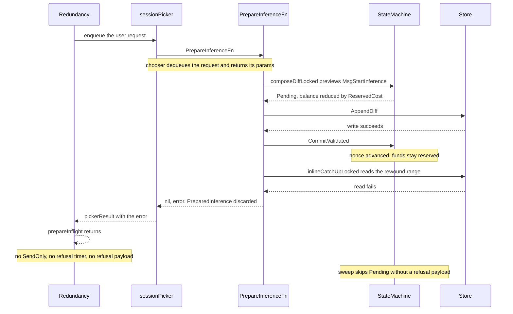

<div class="issues-detail-header">
  <h1 class="issues-detail-title">
    <span class="issues-status issues-status-open"><svg viewBox="0 0 16 16"><path d="M8 9.5a1.5 1.5 0 1 0 0-3 1.5 1.5 0 0 0 0 3Z"/><path d="M8 0a8 8 0 1 1 0 16A8 8 0 0 1 8 0ZM1.5 8a6.5 6.5 0 1 0 13 0 6.5 6.5 0 0 0-13 0Z"/></svg></span>
    [BUG, LOW] A failed inline catch-up read leaves a committed Start with funds reserved
    <span class="issues-number">#2037</span>
  </h1>
  <div class="issues-detail-meta">
    <span class="issues-meta-item">Open</span>
    <span class="issues-meta-item"><a href="https://github.com/a-kuprin">@a-kuprin</a> opened 2026-10-15 20:45 UTC</span>
    <span class="issues-meta-item">0 comments</span>
    <span class="issues-meta-item">Updated 2026-10-16 08:57 UTC</span>
  </div>
  <div class="issues-labels" style="margin-top: 8px;"><span class="issues-label" style="background-color: #d73a4a; color: #ffffff; border-color: #d73a4a;">bug</span> <span class="issues-label" style="background-color: #a2eeef; color: #24292f; border-color: #a2eeef;">enhancement</span></div>
</div>

<div class="issues-content" markdown="1">
## What fails

`PrepareInferenceFn` composes the next diff, then reads the host's catch-up, still holding `Session.mu`:

```go
diff, composedIdx, err := s.composeDiffLocked(persistCtx, txsForDiff)
// ...
catchUp, inline, err := s.inlineCatchUpLocked(hostIdx, nonce)
if err != nil {
    return nil, fmt.Errorf("read catch-up for host %d nonce %d: %w", hostIdx, nonce, err)
}
```

`composeDiffLocked` has already done all of the following before that read:

1. Previewed `MsgStartInference`. The record is `Pending` and `Balance` is reduced by `ReservedCost`.
2. Persisted the diff with `AppendDiff`.
3. Installed that preview with `CommitValidated` and advanced `s.nonce`.

The error return does not roll any of that back. The caller receives `nil, error` and has no `PreparedInference` to send or to time out.

Commit `19811e042` only covers the ghost-burn symptom of this same return. When `chosen` is nil and the nonce moved, the picker loops and keeps the queue. It still has no `PreparedInference`, so `runGhostProbe` does not run, and that ghost `MsgStart` is left `Pending` the same way. A real request is worse: the picker already dequeued it and replies the error to that caller.

```go
case err != nil:
    if chosen != nil {
        chosen.reply <- pickerResult{err: err}
        continue
    }
```

`prepareInflight` then returns. `startInflight` never runs, so there is no `SendOnly`, no refusal timer, and no refusal payload.

## When the read runs

`inlineCatchUpLocked` reads the diffs this host has not applied yet, and only when that gap is still one chunk (`catchUpChunkSize` is 200):

```go
from := s.hostSyncNonce[hostIdx] + 1
if from+catchUpChunkSize <= target {
    return nil, false, nil // far behind; SendOnly reads later, after an inflight exists
}
diffs, err = s.diffRangeLocked(from, min(s.nonce, from+catchUpChunkSize-1))
```

`from` is the host cursor plus one. `target` is the nonce just composed. The result is `[]types.Diff` over `[cursor+1, nonce]`: nonce, transactions, user signature, and post-state root.

The store is touched only for the prefix below the oldest diff still in `s.diffs`. `ReadDiffPages` walks that prefix in pages of at most 64 nonces and 8 MiB of `txs_proto`. Each page is two queries on one snapshot:

* `DiffSizes` — `nonce` and the length of `txs_proto`.
* `GetDiffs` — the blob, user signature, roots, warm-key JSON, then the signature rows.

SQLite uses a read-only transaction. Postgres uses repeatable read. The in-memory tail, including the diff just committed, is appended after that and cannot fail. A gap of 200 or more returns `ok == false` with no error; `SendOnly` loads those chunks later, and a failure there still has an inflight.

All three of the following have to be true, which is why this is rare:

1. A store is configured.
2. The host cursor was rewound, and the gap to this nonce is still under 200. With a store, `RewindHostCatchUp` sends the cursor back to 0.
3. Those nonces are already gone from memory. Once every host cursor had moved past them, `dropDiffPrefixLocked` drops them even when the journal is shorter than the 256-diff cap. The rewind then points into history only the store still has.

## Errors the read can return

`PrepareInferenceFn` wraps whatever `ReadDiffPages` returns as `read catch-up for host %d nonce %d`. The page callback in `storedDiffs` always returns nil, so it adds no error of its own.

* A database error, wrapped as `get diff sizes:` or `get diffs:`. Pool or epoch lookup, a transaction that will not start, a query error, or a scan error. Postgres also uses its own operation deadline, so a slow read comes back as a context deadline.
* A row that will not decode: `unmarshal txs` on `txs_proto`, or `unmarshal warm keys` on `warm_keys_json`.
* A `*storage.DiffGapError` when the rows are readable but the range is not contiguous: `missing nonce N, next stored nonce is M`, or `missing trailing nonces N..M`.

## Why nothing releases the reservation

A successful prepare builds an inflight. If the host never answers, `scheduleDeadlineHandleTimeout` remembers the refusal payload and later `HandleTimeout` votes `TIMEOUT_REASON_REFUSED`, which adds `ReservedCost` back to the balance. That chain needs the `PreparedInference`.

The execution sweep cannot fill in. A `Pending` inference is eligible only when a refusal payload was stored for it:

```go
case types.StatusPending:
    if inference.StartedAt <= 0 || !hasRefusalPayload(nonce) {
        continue
    }
```

`rememberRefusalPayload` runs inside that same timeout scheduler. This nonce never gets there. The diff is durable, so a later catch-up can still teach the host the `MsgStart`, but the gateway has no inflight and no refusal payload for it. The record stays `Pending` and the reserved cost stays locked.



## Direction

Treat a failed inline read the way a long gap is already treated: return the composed diff with `farBehind` set, and let `catchUpForSend` retry the store read outside `Session.mu`. That path already returns the error with no diffs, and it runs after the inflight exists, so a lasting read failure still schedules the refusal timeout. A ghost burn then still reaches `runGhostProbe`.

Returning the error before `composeDiffLocked` is the other safe order, and it is already what a persist failure does. It does not apply once `CommitValidated` has succeeded: the nonce is spent, and dropping the handle is what strands the reservation.

</div>

---

> 🔄 **Auto-synced** from [Issue #2037](https://github.com/gonka-ai/gonka/issues/2037) every hour.
